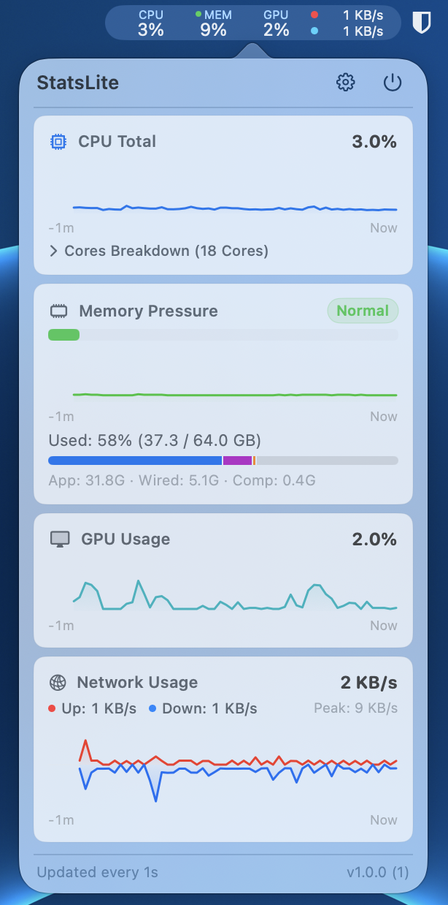

# Stats Lite

[](https://github.com/beliantech/stats-lite/releases/latest/download/StatsLite.dmg)

Stats Lite is a menu-bar system monitor for macOS. It shows live CPU, memory pressure, GPU, temperature, and network metrics in the status bar. Click the status item to open a popover with detail cards and sparklines.

The app runs as a menu-bar agent. It has no Dock icon and no main window.

## Screenshot



## Features

- **Menu bar blocks**: one stacked block per metric. Each block shows a category label and a value. Block widths stay fixed, so the status item never resizes.
  - CPU: total usage.
  - Memory: pressure percentage with a 4 pt pressure dot.
  - GPU: utilization percentage.
  - Temperature: package temperature in °C. Shown by default; turn it off in Settings.
  - Network: two lines. Upload rate with a red dot, download rate with a blue dot.
- **Popover**:
  - Per-metric cards with sparklines and a shared time axis.
  - Expandable Top Processes lists on the CPU and Memory cards.
  - Header buttons: open Storage settings, open Activity Monitor, open Settings, quit.
  - An update banner when a newer release exists on GitHub.
- **Settings window**:
  - Refresh interval: 1, 2, 3, or 5 seconds. Network throughput always refreshes at 1-second intervals.
  - Visible metrics: toggle each metric on or off. At least one metric must stay on.
  - History duration: 30 seconds to 5 minutes.
  - Launch at login.
- **Real system data**: the app reads metrics from Mach APIs, IOKit, `sysctl`, SMC, and `getifaddrs`.

## Goals

- Keep Stats Lite under 60 MB in memory in menu-bar-only mode. Menu-bar-only mode means the status item is visible and the popover is closed.
- Keep the feature set small. Stats Lite does one job: show system metrics at a glance. Every proposed feature must state its user benefit and its memory cost before it is added.

## Requirements

- macOS 14.0 or later.
- Apple Silicon (arm64).
- Full Xcode. Xcode Command Line Tools alone do not work.

Stats Lite has zero third-party dependencies. You do not install anything before you build.

## Build

Open `StatsLite.xcodeproj` in Xcode and run the `StatsLite` scheme.

To build from the command line:

```sh
DEVELOPER_DIR=/Applications/Xcode.app/Contents/Developer \
xcodebuild build \
  -project StatsLite.xcodeproj \
  -scheme StatsLite \
  -destination 'platform=macOS,arch=arm64' \
  -derivedDataPath .derivedData \
  CODE_SIGN_IDENTITY="-"
```

If `xcodebuild` reports that the active developer directory is a Command Line Tools instance, set `DEVELOPER_DIR=/Applications/Xcode.app/Contents/Developer` as shown above.

The build produces `StatsLite.app`. Launch it. The icon appears in the menu bar.

## Test

Run the test suite with this command:

```sh
DEVELOPER_DIR=/Applications/Xcode.app/Contents/Developer \
xcodebuild test \
  -project StatsLite.xcodeproj \
  -scheme StatsLite \
  -destination 'platform=macOS,arch=arm64' \
  -derivedDataPath .derivedData \
  CODE_SIGN_IDENTITY="-"
```

The suite lives in `StatsLiteTests/`. It contains unit, layout, churn, contract, accessibility, and offscreen render-snapshot tests. `MenuBarRenderSnapshotTests.swift` verifies the menu bar pixels in dark and light appearance.

## Project structure

```text
StatsLite.xcodeproj/   Xcode project and shared scheme
StatsLite/             App target (Swift sources)
StatsLiteTests/        XCTest suite
scripts/               Measurement and screenshot scripts
plans/                 Completed development plans
docs/                  Screenshot and research notes
tools/                 Developer probe tools
AGENTS.md              Contributor rules
DESIGN.md              UI design rules
```

Key sources:

| File | Role |
| --- | --- |
| `StatsLite/StatsLiteApp.swift` | Entry point and app delegate |
| `StatsLite/StatusItemController.swift` | Status item and popover lifecycle |
| `StatsLite/SystemMonitor.swift` | Main-actor sampling state |
| `StatsLite/LiveSystemMetricsProvider.swift` | Real metric reads (Mach, IOKit, sysctl, SMC, `getifaddrs`) |
| `StatsLite/MenuBarStackedItemView.swift` | Menu bar rendering |
| `StatsLite/PopoverContentView.swift` | Popover UI |
| `StatsLite/TopProcessesView.swift` | Expandable Top Processes lists |
| `StatsLite/SettingsView.swift` | Settings window |
| `StatsLite/PreferencesStore.swift` | UserDefaults-backed preferences |
| `StatsLite/UpdateCheckService.swift` | GitHub release check and update banner state |

## Scripts

- `scripts/measure_popover_footprint.sh --output <file>` — launch the release build, open the popover, and sample memory with `footprint`.
- `scripts/capture_baseline.sh` — capture dark-mode and light-mode popover screenshots.
- `scripts/capture_menubar.sh` — capture the menu bar status-item strip in dark and light appearance.
- `scripts/windowid.swift` — print the CGWindowID of the open popover window (`swift scripts/windowid.swift`).

Both capture scripts set `DEVELOPER_DIR` when needed.

## Configuration

Preferences save in UserDefaults. There are no config files and no environment variables. Change preferences in the Settings window.

## Updates

The app checks GitHub for a new version once a day. When a newer version exists, the app downloads it and installs it in-app. The app asks you to relaunch after the install.

Every GitHub release also publishes `StatsLite.dmg`. Download it from the latest-release page to install or reinstall the app by hand.

## Privacy

Stats Lite sends no telemetry. No script collects or sends your activity or events, and no metric data leaves your Mac.

The only network request the app makes is an update check: one GET to the GitHub latest-release endpoint, at launch (at most once per 5 minutes) and then once every 24 hours. It reads the newest release version and sends nothing about you or your system.

## Contribute

Read `AGENTS.md` before you edit. One rule to remember: status item views must not use `.animation` or `.contentTransition`. Transitions stay discrete.
