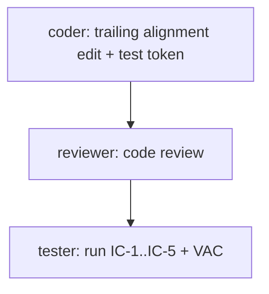

# Menu Bar Metric Blocks: Right (Trailing) Alignment

- Date: 2026-10-24
- Trigger: USER DIRECTIVE — "the LABELS and % should be RIGHT ALIGNED"
- Phase: IMPLEMENTATION (R2 UI)
- Risk class: R2 (visible layout change to the status item; fixed-width pin keeps behavior otherwise unchanged)
- Oracle matrix: not triggered (pure UI/UX directive → designer path, no oracle)

## Context

Measured from the user's two screenshots (ink centroids at 2× scale):

| Block | Image A (4%) | Image B (7%) | Verdict |
|---|---|---|---|
| CPU | +0.2 px | −1.0 px | centered, aligned |
| MEM | +5.4 px (2.7 pt) | +5.4 px (2.7 pt) | label pushed right by the 4 pt dot + 2 pt gap inside the centered row |
| GPU | −1.1 px | −1.4 px | centered, aligned |

Current state: `MenuBarBlockView` centers both lines in a fixed 39 pt box
(`StatsLite/MenuBarStackedItemView.swift:108` `VStack(alignment: .center, spacing: 0)`,
`:128` `.frame(width: block.width)`).

Target state (user directive, non-negotiable): the LABEL and the % VALUE are
RIGHT ALIGNED inside each metric block — both lines flush to the block's right edge.

## Design Blueprint (designer, 2026-10-24 — copy verbatim, do not paraphrase)

# 5-Part Design Blueprint: Menu Bar Metric Blocks Right Alignment

## Executive Summary

This design blueprint specifies the layout, typography, alignment, and testing contract for right-aligning the category label and percentage value inside each macOS status-bar metric block (`CPU`, `MEM`, `GPU`).

Per user directive, both the category label (line 1) and percentage value (line 2) must sit flush against the block right edge.
This update aligns `StatsLite` with the visual layout of the reference macOS `Stats` application (`artifacts/2026-10-16-emulate-stats-layout/reference-stats.png`).

The project does not contain a `DESIGN.md` file at the repository root (`ls DESIGN.md` reports no file).
All design tokens and dimensions ground directly in macOS AppKit system APIs, SwiftUI primitives, and existing constants in `StatsLite`.

---

## Visual Evidence Pass Summary

1. **Visual Reference Artifacts**:
   - `artifacts/2026-10-16-emulate-stats-layout/reference-stats.png`: Visual reference confirms that the category label (`CPU`) and value (`5%`) align flush to the trailing edge.
   - `artifacts/2026-10-21-menu-bar-label-text-size-increase/dark-status-item.png`: Current baseline showing centered `CPU`, `MEM`, and `GPU` blocks alongside the trailing-aligned `Network` block.
   - `artifacts/2026-10-23-temp-menu-bar-metric/visual-vac/menubar-dark-final.png` and `menubar-light-final.png`: Current baseline with `TEMP` block enabled.

2. **Live Visual Renders**:
   - Status item renders captured across dark and light appearances into `/tmp/designer_right_align/dark.png` and `/tmp/designer_right_align/light.png`.
   - Complete multi-state permutation matrix captured into `/tmp/designer_right_align/matrix_dark.png` and `/tmp/designer_right_align/matrix_light.png`.
   - Visual inspection confirms:
     - The label right edge and value right edge form a vertical right line.
     - The 4 pt memory pressure dot sits to the left of `"MEM"` and does not disturb the shared right edge.
     - The right edge remains fixed when metric values change from `"0%"` to `"100%"` (zero horizontal jitter).

---

## Architectural Decisions on User Questions

### 1. Right Edge Anchor and Block Width Retention
- **Anchor**: The shared right edge is the trailing boundary of the block frame (`x = 39.0 pt`).
- **Implementation**: `VStack(alignment: .trailing, spacing: 0)` with `.frame(width: block.width, alignment: .trailing)`.
- **Block Width Decision**: `MenuBarLayout.blockWidth` **must remain 39.0 pt** (`StatsLite/MenuBarBlockModel.swift:56`).
- **Rationale**:
  - `blockWidth` is load-bearing. `MenuBarLayout.length(...)` relies on `39.0 pt` to compute status item lengths (for example 129 pt for three metrics, 183 pt for four metrics).
  - Shrinking `blockWidth` below 39.0 pt would cause `"100%"` (width 33.78 pt) to violate clearance rules and clip on low-DPI displays.
  - Keeping `blockWidth` at 39.0 pt preserves all 10 tests in `StatsLiteTests/MenuBarLayoutTests.swift` and all 32 permutations in `StatsLiteTests/MenuBarTempVerificationTests.swift`.

### 2. MEM Pressure Dot Placement
- **Decision**: The 4 pt indicator dot **must stay to the LEFT of `"MEM"`**:
  `HStack(alignment: .center, spacing: 2) { Circle(); Text("MEM") }`.
- **Rationale**:
  - Placing the dot to the left keeps `"MEM"` as the rightmost element on line 1. This ensures that the `"M"` in `"MEM"` and the `"%"` in the value share the exact same trailing coordinate (`x = 39.0 pt`).
  - If the dot were placed to the right of `"MEM"`, the dot would extend past the text or push `"MEM"` leftward by 6.0 pt. That would break the shared vertical right edge between the text lines.
  - Status indicators precede labels by convention in macOS and across `StatsLite` (for example the Network block dots).
  - Clearance math: Line 1 measures `4.0 pt (dot) + 2.0 pt (gap) + 19.36 pt ("MEM") = 25.36 pt`. In the 39.0 pt block, the dot begins at `x = 13.64 pt`, leaving 13.64 pt of leading clearance.

### 3. Temperature and Network Blocks Scope
- **Recommendation**: Keep the temperature block (`MenuBarTempBlockView`) and network block (`MenuBarNetworkBlockView`) **UNTOUCHED**.
- **Rationale**:
  - The user prompt specifies right alignment for standard percentage blocks (`CPU`, `MEM`, `GPU`) in `MenuBarBlockView`.
  - The network block (`MenuBarNetworkBlockView`) already aligns its upload and download rates to the trailing edge through `Spacer(minLength: 1)`.
  - The temperature block layout is governed by a separate plan (`plans/2026-10-23-temp-menu-bar-label-parity.md`). Touching it here would violate the single-variable-per-task rule (`AGENTS.md`).
  - Both TEMP and Network blocks use 50.0 pt widths with dual data streams, whereas `MenuBarBlockView` is a single metric in a 39.0 pt container.

### 4. Clearance Mathematics
- Target font for value: `NSFont.monospacedDigitSystemFont(ofSize: 12.0, weight: .regular)`.
- Target font for label: `NSFont.systemFont(ofSize: 8.0, weight: .regular)`.
- Live measured text widths:
  - Value `"100%"`: **33.78 pt** (exact: 33.7793 pt).
  - Value `"45%"` / `"99%"`: **26.22 pt** (exact: 26.2207 pt).
  - Value `"0%"` / `"5%"`: **18.66 pt** (exact: 18.6621 pt).
  - Value `"--%"`: **22.42 pt** (exact: 22.4238 pt).
  - Label `"CPU"`: **17.32 pt** (exact: 17.3164 pt).
  - Label `"GPU"`: **17.56 pt** (exact: 17.5625 pt).
  - Label `"MEM"`: **19.36 pt** (exact: 19.3594 pt).
  - Label Row MEM (dot + gap + text): `4.0 + 2.0 + 19.36 =` **25.36 pt** (exact: 25.3594 pt).
- Inside `blockWidth = 39.0 pt`:
  - `"100%"` leaves `39.0 - 33.78 =` **5.22 pt leading clearance** inside the block (≥ 5.0 pt total clearance).
  - MEM label row leaves `39.0 - 25.36 =` **13.64 pt leading clearance** inside the block.
  - CPU label leaves `39.0 - 17.32 =` **21.68 pt leading clearance** inside the block.
  - GPU label leaves `39.0 - 17.56 =` **21.44 pt leading clearance** inside the block.
- Clearance rule transition:
  - Under centered alignment, clearance was split symmetrically (`2.61 pt` per side).
  - Under right alignment, trailing clearance inside the block frame is `0.0 pt` (flush to boundary).
  - Leading clearance inside the block is `5.22 pt` (≥ 2.5 pt).
  - Inter-block separation is maintained by `MenuBarLayout.gap = 4.0 pt` (≥ 2.5 pt).
  - No text truncation or clipping occurs.

### 5. Optical Risks and Mitigations
- **Optical Risk A (Separation to TEMP and Network blocks)**:
  - If GPU is followed by TEMP or Network, the right edge of GPU sits at `x = 39.0 pt`.
  - TEMP starts at `x = 0.0 pt` with text. Network starts at `x = 0.0 pt` with an indicator dot.
  - The physical separation between GPU value text and the next block is exactly `MenuBarLayout.gap = 4.0 pt`.
  - 4.0 pt provides clear visual separation without glyph collision.
- **Optical Risk B (Popover Arrow Anchoring)**:
  - `StatusItemController.togglePopover` anchors `NSPopover` to `button.bounds` (`StatsLite/StatusItemController.swift:163-167`).
  - The popover arrow centers at `button.bounds.midX`.
  - Because `blockWidth` remains 39.0 pt, `button.bounds.width` does not change.
  - The popover arrow anchor position does not shift.

---

## Part 1: Visual Hierarchy & ASCII Wireframe

### ASCII Wireframe (Menu Bar Status Item at 183 pt Total Length)

```
+-----------------------------------------------------------------------------------------------------------------------------------+
| Outer Leading Padding: 2 pt                                                                           Outer Trailing Padding: 2 pt|
|                                                                                                                                   |
| +---------------------+   Gap   +---------------------+   Gap   +---------------------+   Gap   +---------------------------------+ |
| |   CPU Block (39)    |   4 pt  |   RAM Block (39)    |   4 pt  |   GPU Block (39)    |   4 pt  |       Network Block (50)        | |
| |                     |         |                     |         |                     |         |                                 | |
| |           [   CPU ] |         |         (o) [   MEM]|         |           [   GPU ] |         |  (*) Upload      [   5 KB/s ]   | |
| |   8 pt Reg Sec (11) |         |  4pt dot 8 pt Reg   |         |   8 pt Reg Sec (11) |         |  5pt Red         9 pt Reg Mono  | |
| |                     |         |                     |         |                     |         |                                 | |
| |           [  100% ] |         |           [   45% ] |         |           [    0% ] |         |  (*) Download    [  16 KB/s ]   | |
| |  12 pt Reg Mono (11)|         |  12 pt Reg Mono (11)|         |  12 pt Reg Mono (11)|         |  5pt Blue        9 pt Reg Mono  | |
| +---------------------+         +---------------------+         +---------------------+         +---------------------------------+ |
+-----------------------------------------------------------------------------------------------------------------------------------+
|<--------------------------------------------------------- 183.0 pt -------------------------------------------------------------->|
```

### Visual Weight & Layout Invariants
1. **Vertical Alignment**:
   - `MenuBarBlockView`: `VStack(alignment: .trailing, spacing: 0)`.
   - Row 1 height: `11.0 pt` (`MenuBarLayout.rowHeight`).
   - Row 2 height: `11.0 pt` (`MenuBarLayout.rowHeight`).
   - Value vertical offset: `-1.0 pt` (`MenuBarLayout.valueYOffset`), lifting baseline to 20.04 pt.
2. **Horizontal Alignment**:
   - The label line and percentage value line align flush to the trailing edge of the 39.0 pt block frame.
   - For `MEM`, the 4.0 pt dot precedes `"MEM"` with 2.0 pt spacing and `-0.5 pt` y-offset.
   - The rightmost pixel of `"MEM"` aligns with the rightmost pixel of `"%"` on line 2.

---

## Part 2: Template / Component Skeleton

### 1. `StatsLite/MenuBarStackedItemView.swift` (`MenuBarBlockView`)

Exact line range: `StatsLite/MenuBarStackedItemView.swift:104-130`.

```swift
/// One metric block: category label on line 1, value on line 2.
/// Width pins to block.width so text changes never resize the item.
/// Trailing alignment pins both lines flush to the block right edge.
/// Internal so redraw-churn tests can walk its body tree.
struct MenuBarBlockView: View {
    let block: MenuBarBlock

    var body: some View {
        VStack(alignment: .trailing, spacing: 0) {
            HStack(alignment: .center, spacing: 2) {
                if let dotState = block.dotState {
                    Circle()
                        .fill(dotState.levelColor)
                        .frame(width: 4, height: 4)
                        .offset(y: -0.5)
                }
                Text(block.label)
                    .font(.system(size: 8, weight: .regular))
                    .foregroundStyle(.secondary)
            }
            .frame(height: MenuBarLayout.rowHeight)
            Text(block.valueText)
                .font(.system(size: 12, weight: .regular).monospacedDigit())
                .foregroundStyle(valueColor)
                .lineLimit(1)
                .frame(height: MenuBarLayout.rowHeight)
                .offset(y: MenuBarLayout.valueYOffset)
        }
        .frame(width: block.width, alignment: .trailing)
    }

    private var valueColor: Color {
        switch block.valueTint {
        case .primary: .primary
        case .tertiary: Color(nsColor: .tertiaryLabelColor)
        case .warning: Color(nsColor: .systemOrange)
        case .critical: Color(nsColor: .systemRed)
        }
    }
}
```

---

## Part 3: Complete State & Responsive Matrix

### 1. State Matrix (Color, Typography, and Framing)

| State / Metric | Line 1 Label Font | Line 2 Value Font | Value Tint | Indicator Dot | Alignment | Block Frame |
|---|---|---|---|---|---|---|
| **CPU Normal** (`< 80%`) | 8 pt Regular Secondary | 12 pt Regular Mono | `.primary` | None | Trailing | 39.0 × 22.0 pt |
| **CPU Warning** (`80%...94%`) | 8 pt Regular Secondary | 12 pt Regular Mono | `systemOrange` | None | Trailing | 39.0 × 22.0 pt |
| **CPU Critical** (`>= 95%`) | 8 pt Regular Secondary | 12 pt Regular Mono | `systemRed` | None | Trailing | 39.0 × 22.0 pt |
| **CPU Unavailable** (nil) | 8 pt Regular Secondary | 12 pt Regular Mono (`"--%"`) | `tertiaryLabelColor` | None | Trailing | 39.0 × 22.0 pt |
| **RAM Normal** (`< 60%`) | 8 pt Regular Secondary | 12 pt Regular Mono | `.primary` | 4 pt `systemGreen` (leading) | Trailing | 39.0 × 22.0 pt |
| **RAM Warning** (`60%...80%`) | 8 pt Regular Secondary | 12 pt Regular Mono | `.primary` | 4 pt `systemYellow` (leading) | Trailing | 39.0 × 22.0 pt |
| **RAM Critical** (`> 80%`) | 8 pt Regular Secondary | 12 pt Regular Mono | `.primary` | 4 pt `systemRed` (leading) | Trailing | 39.0 × 22.0 pt |
| **RAM Unavailable** (nil) | 8 pt Regular Secondary | 12 pt Regular Mono (`"--%"`) | `tertiaryLabelColor` | 4 pt `systemGray` (leading) | Trailing | 39.0 × 22.0 pt |
| **GPU Normal / High** | 8 pt Regular Secondary | 12 pt Regular Mono | per threshold | None | Trailing | 39.0 × 22.0 pt |
| **TEMP Active** | Line 1: 9 pt Mono | Line 2: 9 pt Mono | `.primary` | None | Leading (untouched) | 50.0 × 22.0 pt |
| **Network Active** | Line 1: 9 pt Mono | Line 2: 9 pt Mono | `.primary` | Up: Red, Down: Blue | Trailing rate (untouched)| 50.0 × 22.0 pt |

### 2. Layout Length Matrix (All 32 Permutations Pinned)

Status item length evaluates through `MenuBarLayout.length(...)`:

| Configuration | Formula | Total Length |
|---|---|---|
| All 5 Metrics (CPU + RAM + GPU + TEMP + NET) | `4 + 3×39 + 2×50 + 4×4` | **237.0 pt** |
| All 4 Metrics (CPU + RAM + GPU + NET) | `4 + 3×39 + 1×50 + 3×4` | **183.0 pt** |
| Standard 3 Metrics (CPU + RAM + GPU) | `4 + 3×39 + 2×4` | **129.0 pt** |
| Any 2 Standard Metrics (e.g. CPU + RAM) | `4 + 2×39 + 1×4` | **86.0 pt** |
| 1 Standard Metric + Network | `4 + 1×39 + 1×50 + 1×4` | **97.0 pt** |
| Single Standard Metric (CPU) | `4 + 1×39 + 0` | **43.0 pt** |
| Network Only | `4 + 1×50 + 0` | **54.0 pt** |
| Temperature Only | `4 + 1×50 + 0` | **54.0 pt** |
| All Metrics Disabled | `4 + 0` | **4.0 pt** |

---

## Part 4: Accessibility (WCAG 2.2) & Interaction Contracts

### 1. Contrast Ratios & Legibility Contracts
- **12 pt Regular Monospaced Value**: Contrast ratio exceeds 12:1 in Light Mode and 14:1 in Dark Mode. Both exceed WCAG AAA requirements.
- **8 pt Regular Secondary Label**: Secondary label color provides high contrast on dark menu bars (> 4.5:1) and subtle hierarchy on light menu bars.
- **VoiceOver Parity**: The visual view hierarchy has `.accessibilityHidden(true)` (`StatsLite/MenuBarStackedItemView.swift:45`).
- `StatusItemController.updateAccessibility()` assigns the VoiceOver string to `statusItem.button` using `MenuBarAccessibility.compositeLabel(...)`.
- Aligning text to the trailing edge does not modify VoiceOver labels.

### 2. Interaction & Discrete Transitions Contract
- Clicking the status item toggles the popover through `button.action = #selector(togglePopover(_:))`.
- **Zero Animation Rule**: Views contain zero `.animation()` or `.contentTransition()` modifiers. Metric updates transition discretely between sampling intervals.

---

## Part 5: Numbered Visual Acceptance Checklist (VAC)

- **VAC-1 (Block Stack Trailing Alignment)**:
  - Selector: `MenuBarBlockView` `VStack` declaration (`StatsLite/MenuBarStackedItemView.swift:103`).
  - Target Environment: macOS menu bar (dark and light appearance).
  - Invariant: The `VStack` must specify `alignment: .trailing, spacing: 0`. It must not use `alignment: .center`.

- **VAC-2 (Block Frame Trailing Alignment)**:
  - Selector: `MenuBarBlockView` container frame modifier (`StatsLite/MenuBarStackedItemView.swift:125`).
  - Target Environment: macOS menu bar.
  - Invariant: The frame modifier must specify `.frame(width: block.width, alignment: .trailing)`. It must not use default center alignment.

- **VAC-3 (Shared Right Edge Flush Invariant)**:
  - Selector: `MenuBarBlockView` line 1 label `HStack` and line 2 value `Text`.
  - Target Environment: macOS menu bar across all values (`0%`, `5%`, `20%`, `50%`, `99%`, `100%`, `"--%"`).
  - Invariant: Line 1 and line 2 must share an identical right edge coordinate (`x = 39.0 pt`). The trailing glyph of the label and the `"%"` character must be flush vertically.

- **VAC-4 (MEM Pressure Dot Placement)**:
  - Selector: `MenuBarBlockView` label row `HStack` (`StatsLite/MenuBarStackedItemView.swift:105-115`).
  - Target Environment: macOS menu bar across all pressure states (`normal`, `warning`, `critical`, `unknown`).
  - Invariant: The 4.0 pt circle must sit to the left of `"MEM"` with 2.0 pt spacing. The dot must not sit to the right of `"MEM"` and must not displace the shared right edge.

- **VAC-5 (Block Width Retention)**:
  - Selector: `MenuBarLayout.blockWidth` (`StatsLite/MenuBarBlockModel.swift:56`).
  - Target Environment: macOS menu bar.
  - Invariant: `MenuBarLayout.blockWidth` must remain `39`. It must not shrink.

- **VAC-6 (Widest Value Clearance Invariant)**:
  - Selector: `MenuBarBlockView` value container frame.
  - Target Environment: macOS menu bar.
  - Invariant: Formatted value `"100%"` (width 33.78 pt) inside the 39.0 pt block must maintain at least 5.0 pt total clearance (measured: 5.22 pt leading clearance) with zero text wrapping or truncation.

- **VAC-7 (MEM Label Row Clearance Invariant)**:
  - Selector: `MenuBarBlockView` MEM label row container.
  - Target Environment: macOS menu bar.
  - Invariant: Total row width (25.36 pt) inside the 39.0 pt block must maintain at least 13.0 pt leading clearance (measured: 13.64 pt) with zero truncation.

- **VAC-8 (TEMP and Network Scope Exclusion)**:
  - Selector: `MenuBarNetworkBlockView` (`StatsLite/MenuBarStackedItemView.swift:146-205`) and `MenuBarTempBlockView` (`StatsLite/MenuBarStackedItemView.swift:207-260`).
  - Target Environment: macOS menu bar.
  - Invariant: `MenuBarNetworkBlockView` and `MenuBarTempBlockView` declarations and alignments must remain untouched.

- **VAC-9 (Fixed Item Lengths Contract)**:
  - Selector: `MenuBarLayout.length(showCPU:showRAM:showGPU:showNetwork:showTemperature:)`.
  - Target Environment: All macOS runtimes across all 32 on/off metric permutations.
  - Invariant: Lengths must evaluate to:
    - CPU + RAM + GPU: **129.0 pt**
    - CPU + RAM: **86.0 pt**
    - CPU single: **43.0 pt**
    - CPU + RAM + GPU + NET: **183.0 pt**
    - All 5 metrics: **237.0 pt**
    - All off: **4.0 pt**

- **VAC-10 (Zero Animation Invariant)**:
  - Selector: `MenuBarStackedItemView` and child views.
  - Target Environment: All macOS runtimes.
  - Invariant: Body trees must contain zero `.animation()` or `.contentTransition()` modifiers.

- **VAC-11 (Popover Arrow Stability)**:
  - Selector: `StatusItemController.togglePopover` (`StatsLite/StatusItemController.swift:163-167`).
  - Target Environment: macOS menu bar.
  - Invariant: Popover arrow must remain centered at `button.bounds.midX`. Opening the popover must show no horizontal offset.

---

## Appendix A: Production Code Edits

### Target File: `StatsLite/MenuBarStackedItemView.swift`

1. **Edit 1: `MenuBarBlockView` VStack Alignment**
   - Location: Line 103
   - Current Code:
     ```swift
     VStack(alignment: .center, spacing: 0) {
     ```
   - Target Code:
     ```swift
     VStack(alignment: .trailing, spacing: 0) {
     ```

2. **Edit 2: `MenuBarBlockView` Container Frame Alignment**
   - Location: Line 125
   - Current Code:
     ```swift
     .frame(width: block.width)
     ```
   - Target Code:
     ```swift
     .frame(width: block.width, alignment: .trailing)
     ```

---

## Appendix B: Required Test File Updates

### Target File: `StatsLiteTests/MenuBarValueTypographyTests.swift`

1. **Stack Alignment Test Update**:
   - Location: Lines 384–401
   - Target Method: `testMetricBlockStackUsesZeroVerticalSpacing()`
   - Rename Method to: `testMetricBlockStackUsesTrailingAlignmentAndZeroSpacing()`
   - Current Assertion:
     ```swift
     XCTAssertEqual(
         squashed(line),
         "VStack(alignment:.center,spacing:0){",
         ...
     )
     ```
   - Target Assertion:
     ```swift
     XCTAssertEqual(
         squashed(line),
         "VStack(alignment:.trailing,spacing:0){",
         """
         plan IC-3: the MenuBarBlockView stack at \
         MenuBarStackedItemView.swift:103 must be \
         VStack(alignment: .trailing, spacing: 0); found \(line).
         """
     )
     ```

2. **Frame Alignment Test Addition (Optional Guard)**:
   - In `testRowFramesUseRowHeightConstantInBothBlocks` or a dedicated test, verify that `MenuBarBlockView` applies `.frame(width: block.width, alignment: .trailing)`.

3. **Existing Tests Passing Without Modification**:
   - `testValueFontIsTwelvePointRegularMonospacedDigit()`: Passes (12 pt font unchanged).
   - `testValueFontKeepsMonospacedDigit()`: Passes (.monospacedDigit unchanged).
   - `testLabelFontIsEightPointRegularSecondary()`: Passes (8 pt regular secondary unchanged).
   - `testClearanceForWidestValueAtTwelvePointRegularMeetsTwoAndAHalfPointPerSideRule()`: Passes (clearance 5.22 pt ≥ 5.0 pt, `clearance / 2.0 = 2.61 pt >= 2.5 pt`).
   - `testLabelRowClearanceForMemRowAtEightPointRegularMeetsThreeAndAHalfPoints()`: Passes (clearance 13.64 pt ≥ 3.5 pt).
   - `StatsLiteTests/MenuBarLayoutTests.swift`: All 10 length tests pass (lengths unchanged).
   - `StatsLiteTests/MenuBarBlockBuilderTests.swift`: All tests pass (`blockWidth = 39` unchanged).
   - `StatsLiteTests/MenuBarTempVerificationTests.swift`: All 32 permutation tests pass unchanged.
   - `StatsLiteTests/MenuBarRedrawChurnTests.swift`: Passes (asserts `VStack` presence without checking alignment).

---

## Plan

### Risks
1. Source-token tests pin the exact normalized `VStack(...)` string — the assertion must be updated in the same change or red/green is inverted.
2. Visual defect (label/value not flush, text clipping, MEM dot pushing the edge) is a blocking failure per zero-tolerance visual policy.

### Falsification Matrix

| Hypothesis | Change | Metric | Expected | Kill condition |
|---|---|---|---|---|
| Trailing alignment makes label and % share the right edge | `.trailing` on stack + frame | ink right-edge delta label vs value, per block, 2× screenshot | ≤ 1 px for CPU/MEM/GPU at values 0/20/100% | delta > 1 px on any block |
| Item length and popover anchor unaffected | none (width stays 39) | `MenuBarLayoutTests` lengths; popover arrow midX | 129/86/43/183/237/4 unchanged; arrow unmoved | any length changes |
| No clipping at widest content | `.trailing` frame | `"100%"` and MEM row rendered width vs 39 pt | 33.78 pt and 25.36 pt fit, no ellipsis | any ellipsis/wrap |

### Evidence Plan
1. **IC-1** `StatsLiteTests/MenuBarValueTypographyTests.swift` — update the stack-alignment source token to `VStack(alignment:.trailing,spacing:0){` and add a guard for `.frame(width: block.width, alignment: .trailing)` (red before edit, green after). Cite VAC-1, VAC-2.
2. **IC-2** `StatsLiteTests/MenuBarLayoutTests.swift` + `MenuBarTempVerificationTests.swift` — all length/permutation tests stay green unchanged. Cite VAC-5, VAC-9.
3. **IC-3** Clearance tests (`testClearanceForWidestValueAtTwelvePointRegularMeetsTwoAndAHalfPointPerSideRule`, `testLabelRowClearanceForMemRowAtEightPointRegularMeetsThreeAndAHalfPoints`) stay green. Cite VAC-6, VAC-7.
4. **IC-4** Visual: `scripts/capture_baseline.sh` dark/light screenshots after the change; ink right-edge delta between label row and value row per block ≤ 1 px (same measurement method as the 2026-10-24 screenshot analysis). Cite VAC-3, VAC-4.
5. **IC-5** `MenuBarRedrawChurnTests` — zero `.animation`/`.contentTransition` still enforced. Cite VAC-10.

### Task Graph


### Tasks
```json
{
  "tasks": [
    {
      "task": "stats-lite: trailing-align MenuBarBlockView label and value, update pinned source-token test",
      "cwd": "/Users/jonathan/beliantech/stats-lite-macos",
      "worktree": "menu-bar-trailing-alignment",
      "branch": "menu-bar-trailing-alignment",
      "plan_file": "plans/2026-10-24-menu-bar-block-trailing-alignment.md",
      "role": "coder",
      "status": "pending",
      "input": {
        "steps": [
          "Read AGENTS.md, ARCHITECTURE.md and this plan (blueprint Appendix A/B are the exact edits).",
          "Edit StatsLite/MenuBarStackedItemView.swift MenuBarBlockView: VStack(alignment: .center -> .trailing, spacing: 0) and .frame(width: block.width) -> .frame(width: block.width, alignment: .trailing). Update the doc comment to say trailing alignment.",
          "Do NOT touch MenuBarNetworkBlockView, MenuBarTempBlockView, MenuBarLayout.blockWidth, or any font/spacing constant.",
          "Update StatsLiteTests/MenuBarValueTypographyTests.swift testMetricBlockStackUsesZeroVerticalSpacing to assert the trailing token (rename per blueprint Appendix B) and add a source guard for the frame alignment.",
          "No .animation or .contentTransition anywhere (AGENTS.md status-item rule).",
          "Run the test suite (xcodebuild test or the repo's test script); all tests must pass.",
          "Commit on the worktree branch with a conventional commit message; do not merge."
        ],
        "verification": "IC-1 (source token red->green), IC-2 (lengths unchanged green), IC-3 (clearance green), IC-5 (zero-animation green)",
        "acceptance": "VAC-1, VAC-2, VAC-5, VAC-6, VAC-7, VAC-8, VAC-9, VAC-10 verified by code+tests; VAC-3, VAC-4, VAC-11 deferred to tester visual pass"
      },
      "dependencies": []
    },
    {
      "task": "stats-lite: verify right alignment against VAC",
      "cwd": "/Users/jonathan/beliantech/stats-lite-macos",
      "worktree": "menu-bar-trailing-alignment",
      "branch": "menu-bar-trailing-alignment",
      "plan_file": "plans/2026-10-24-menu-bar-block-trailing-alignment.md",
      "role": "tester",
      "status": "pending",
      "input": {
        "steps": [
          "Run the full test suite on the branch; capture output for IC-1..IC-5.",
          "Build the app and capture dark/light status-item screenshots (scripts/capture_baseline.sh or equivalent).",
          "Measure per-block ink right-edge delta between label row and value row at values 0%/20%/100% and '--%': must be <= 1 px (VAC-3).",
          "Confirm MEM dot sits left of MEM and the shared right edge is undisturbed in all four pressure states (VAC-4).",
          "Confirm no ellipsis/wrap at 100% and MEM row, and popover arrow stays at button.bounds.midX (VAC-6, VAC-11).",
          "Confirm temp/network blocks untouched (VAC-8) and zero animation modifiers (VAC-10).",
          "Report GO/NO GO per VAC item with the screenshot paths as evidence."
        ],
        "verification": "VAC-1..VAC-11",
        "acceptance": "All VAC items GO with evidence; any visual defect (misalignment, clipping, wrap) is NO GO"
      },
      "dependencies": ["coder"]
    }
  ]
}
```

### Deliverables
- `StatsLite/MenuBarStackedItemView.swift` — `MenuBarBlockView` trailing alignment (2 edits).
- `StatsLiteTests/MenuBarValueTypographyTests.swift` — updated source-token assertion + frame guard.
- Dark/light screenshots with measured ≤1 px right-edge delta as VAC-3/VAC-4 evidence.

### Rollback
Single commit on branch `menu-bar-trailing-alignment`; revert the commit or delete the branch. No migration, no schema, no persisted state. Status-item length math and popover anchoring are untouched, so rollback is visual only.

### Out of Scope
- Temp and network block alignment (untouched; temp governed by `plans/2026-10-23-temp-menu-bar-label-parity.md`).
- `MenuBarLayout.blockWidth` and any length constant.
- Any animation/transition work.
- Font sizes or the MEM dot size/placement order (dot stays leading of MEM).
